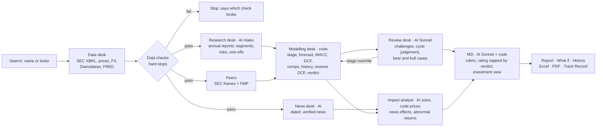

# Stock Valuation Tool

An equity research and valuation tool for US-listed companies, built as a portfolio project. Type a company name
or ticker; a team of "desks" fetches the filings, checks the data, builds a forecast and a full valuation (DCF,
comps, historical multiples, scenarios, reverse DCF, sum of the parts), challenges its own assumptions and writes an
investment view with a rating. Every number in the report can be traced back to its filing, XBRL tag and fetch time,
or to the formula and inputs that produced it. The model downloads as an Excel file with live formulas.

> Private project. Based on assumptions and public data; may contain errors; **not financial advice**.

## How it works: the desks

Plain code does the data and the maths. AI only reads, judges and writes, and every number it writes is checked
against the computed results.



| # | Desk | Type | Job |
|---|---|---|---|
| 1 | Data desk | Code | Fetch up to ten years of XBRL facts from SEC EDGAR (refetched whenever a newer 10-Q or 10-K has been filed), normalise units and FX, build LTM, cross-check against FMP |
| 2 | Data checks | Code | Hard stops (balance sheet out by more than 0.5%, market cap more than 3% from FMP's) and red/amber flags |
| 3 | Research desk | AI (Haiku) | Read the latest annual report (and the reports from two and four years back for one-off items): segments, geography, KPIs, risks, one-offs, convertibles, share classes. Every quote and number is verified against the filing text |
| 4 | News desk | AI (web search) | Company, industry and macro news; anything undated, stale or unverifiable is dropped |
| 5 | Modelling desk | Code | Classify the life-cycle stage, build the forecast, run every valuation method, blend them and apply the verdict rules |
| 6 | Review desk | AI (Sonnet) | Challenge the weakest assumptions, review the stage, judge the cycle, write the strongest bear and bull cases |
| 7 | Impact analyst | AI sizes, code prices | Size each material news item's effect on the model; code reprices it and measures the abnormal return against the S&P 500 and the sector ETF |
| 8 | MD | AI (Sonnet) + code | Score the qualitative half of the rubric; code scores the rest, maps it to a rating, allows one notch and caps the rating by the verdict |

## What a report analyses

**Header.** Price, blended fair value, upside, verdict (Undervalued / Fairly valued / Overvalued) with confidence,
the MD's rating and conviction, the DCF bear-to-bull range against the price, analyst targets, WACC and flags.

**Rating.** Nine criteria scored 1-5: four by code (valuation gap, business quality, financial strength, estimate
revisions) and five by the MD with cited evidence (moat, management, governance, industry, catalysts). The weighted
score maps to Strong Sell ... Strong Buy; the MD may move it one notch with a written reason. **The rating cannot
point against the valuation:** an Overvalued verdict caps it at Hold, an Undervalued one floors it at Hold.

**Valuation** (corporate toolkit):
- *Stage classification* (early, high growth, mature growth, mature stable, cyclical, declining) from growth,
  margins, volatility and profitability history; it decides which methods and fades apply.
- *Forecast*: analyst consensus for every year with at least three analysts, then a fade to industry growth and the
  target margin; the source of every driver is stated. Margins are cleaned of one-off items read from three annual
  reports (KO's FY2025 clean margin equals its reported comparable margin of 31.2%).
- *WACC*: FRED 10-year yield + industry beta (Damodaran, relevered) x implied ERP + country risk weighted by the
  company's revenue geography; synthetic-rating cost of debt. Industry beta and margin come from Damodaran's US,
  global or emerging-markets dataset; an emerging-market listing that earns at least half its revenue in developed
  markets is benchmarked on the global industry (TSM, 90%: beta 1.87 not 1.98, industry margin 27% not 20%).
- *DCF* on operating income (never net income), with a terminal ROIC fade and the statutory terminal tax rate.
- *Sum of the parts* when segments have materially different margins or growth: segment revenue and operating
  income read from the 10-K's XBRL segment note (the research desk's reading of the text as the fallback), each
  segment valued on its US-listed comparables' median EV/EBIT (EV/Sales if it has no operating profit), unallocated
  corporate costs capitalised and deducted; it replaces the DCF in the blend. Comparables listed only at home (e.g.
  Coca-Cola FEMSA) are used with their market cap converted at FRED's rate. *Comparable companies* (peers from SEC
  frames, EV/Sales dropped when the margin gap to peers makes it misleading); *own five-year multiples*.
- *Reverse DCF*: the growth or margin the price implies, the discount rate the price implies, and a DCF on
  sell-side conventions, so the gap to analysts' targets is explained rather than hidden.
- *Scenarios and sensitivity*: bear / base / bull, and WACC x terminal growth and growth x margin grids.
- *Explaining the valuation* (cross-checks, not in the fair value):
  - **Walk from our DCF to the share price**: a waterfall that changes one assumption at a time (today's margin
    held, the company's own tax rate, today's ROIC held, 3% terminal growth, each only where more generous than
    ours), then solves the discount rate the price needs. The bars add up exactly to the gap.
  - **What the price pays for**: no-growth value (year-1 NOPAT / WACC) against growth, for our DCF and for the
    market's enterprise value.
  - **Return on new capital** (Damodaran's "are you reinvesting enough for your growth?"): the rise in NOPAT over
    the forecast divided by its total reinvestment. Amber flag when it is below WACC although today's ROIC is above
    it, with the margin fall named when it is 5 points or more (TSM, 1 Nov run: 15.3% against a 12.0% WACC and 47%
    today, as its margin fades from 58% to 42.5%, so no flag; MSFT 50.1%, KO 32.8%); an information flag
    when profit falls while the forecast reinvests (CVX's cyclical normalisation).
  - **Dividend cross-check** (dividend yield of 1% or more): a two-stage dividend model, dividends growing with the
    DCF's operating profit after tax (constant payout) then at terminal growth, at the cost of equity; and the
    dividend growth for ever the price implies, (P x CoE - D0) / (P + D0). KO: $36.10 against a $94.08 price, which
    needs 5.9% a year; CVX: $138.64 against $235.52 (3.1%).
  - **Tornado**: each input moved alone to its bear and bull setting (sales-to-capital +/-20%), sorted by swing.
    KO: revenue growth $37.25-$47.76, WACC $38.75-$46.41, margin $37.65-$45.28, sales-to-capital barely matters.
    CVX: the margin swings it most ($75.86-$157.53).
  - **Monte Carlo range**: 2,000 DCFs drawing growth, margin, WACC and terminal growth, each spread so its
    10th-90th percentile range equals the bear-bull step (fixed seed, repeatable). Growth and margin move together
    at the company's own measured correlation (revenue growth against the change in operating margin, at least six
    years, capped at +/-0.8; CVX 0.95, MSFT 0.43, KO -0.28). With a shorter history it is pooled with the peers'
    histories, each firm measured against its own averages (GRAB: -0.18 over 43 company-years, six firms). The
    independent range is shown alongside.
  - **Regression-based peer multiples**: EV/Sales against operating margin and EV/EBITDA against revenue growth
    across the peers (needs five), giving the multiple the company warrants at its own margin or growth.

Banks, insurers and REITs get their own toolkits (justified P/TBV or P/B, residual income, dividend discount, NAV
on a peer-implied cap rate, P/FFO) because a DCF does not fit them.

**Financial analysis.** Growth, profitability, returns (ROIC, ROE with DuPont), quality of earnings, working capital,
leverage and debt maturities, capital allocation, the EPS track record of the last 12 quarters, Beneish M-score,
Altman Z and Piotroski F-score (nine pass/fail strength tests; KO 7, MSFT 6, TSM 9), and benchmarking against Damodaran industry medians and the peer set.

**News, ownership and review.** Dated news with each item's sized effect and whether the market has priced it in;
insider transactions (Form 4), major holders (13D/G) and short interest; the review desk's challenges and cases; every
flag explained.

**Interactive tabs.** *What if*: sliders for WACC, terminal growth, growth, margin and terminal ROIC reprice the DCF
in Python (about 10 ms), with presets for the base case, sell-side conventions and the market's discount rate.
*History*: fair value against price across every dated report of the company, with a code-written note of what
changed. *Edit assumptions*: rerun the whole valuation on your inputs. *Desk log*: every desk's status and the number
guard's log.

**Exports.** An Excel model with live formulas (blue inputs, green links, red check rows) whose fair value equals
the app's, and a PDF of the full report. Every formula's result is also stored in the file, so the sheets show numbers
in Excel's Protected View and in phone or browser previews. Tabs: Cover, Inputs, Historicals, Ratios, WACC, DCF,
Forecast, Calc, Scenarios, Sensitivity, SOTP (when applied: segment metric x comparables' multiple), Comps, Hist
multiples, Summary, and Analysis: the walk from our DCF to the price, the no-growth split as formulas on the DCF tab,
the Monte Carlo percentiles, the peer regressions rebuilt with Excel's SLOPE, INTERCEPT and RSQ, the dividend
cross-check on the DCF tab's NOPAT, and the tornado. Both files are
built only when their button is clicked.

**Other pages.** Compare (two saved reports side by side, with key metrics, cross-checks and multiples), Track Record (every call with the MD's reasons, and the
price move since), How it works, Talking points (how to explain the tool in an interview, with a worked
example read live from a saved report) and a Debug page with the raw responses.

## Accuracy safeguards

- All arithmetic is Python; AI reads, judges and writes. Every figure is stored with value, currency, unit, period,
  source, XBRL tag and fetch time, and can be traced from the report.
- US GAAP and IFRS tag maps with fallbacks; restated figures; non-December and 52/53-week years; ADR ratios; FX from
  FRED (period averages for flows, period ends for balances).
- EDGAR is cross-checked against FMP on revenue, net income, cash, debt and shares (amber flag above 2%).
- Flags include net income far above operating income, negative FCF, terminal value above 80% of EV, WACC outside
  6-15%, convertible debt, multiple share classes and margins near a 10-year high (possible cyclical peak).
- Every number in AI text is checked against the computed results; a failing sentence is regenerated once, then
  dropped and logged. Fetched text is data, never instructions. The AI desks never see the user's view of a stock.
- If the Anthropic API fails (e.g. out of credit) the report still completes its valuation without the AI desks.

## Why the DCF is often below analysts' targets

Sell-side targets are mostly multiples. On a 7-8% WACC built from a 5% risk-free rate, quality large caps trading at
2-3% free-cash-flow yields come out well below their prices. The report shows why: for KO the price implies a
discount rate well below the model's 7.9%. The walk to the price splits the gap (KO, 1 Nov 2026): our DCF is
$42.23; four sell-side conventions add $10.36; the remaining $41.49 needs a WACC of 5.7%. The model keeps its own
assumptions and says so.

### Code layout

| Package | What |
|---|---|
| `core/` | Settings (`.env` / Streamlit secrets), response cache with per-source TTLs (a failed refresh falls back to the last good copy, up to 30 days old, 7 for consensus, never for prices or news, keeping its fetch date), HTTP with rate limits and key redaction, store on SQLite (local) or Postgres (deployed) |
| `datasources/` | SEC EDGAR, FMP, FRED, Damodaran, Tiingo and Finnhub clients; FMP-first market data with free fallbacks |
| `data_desk/` | XBRL extraction (US GAAP + IFRS tag map, restatements, 52/53-week years, LTM), derived lines, FX, data checks, peers, filing text, ownership |
| `engine/` | **Pure** valuation engine: classification, forecast, WACC, DCF, scenarios, reverse DCF, comps, history multiples, SOTP, financial-sector toolkits, forensic scores, verdict, rubric, news repricing |
| `desks/` | AI client (structured outputs, cost caps, response cache), number guard, research / news / review / impact / MD desks, modelling desk, pipeline |
| `exports/` | Excel model with live formulas, PDF report, formula verifier |
| `views/`, `ui/` | Streamlit app: password gate, search, run screen, report (incl. What if and History), Compare, Track Record, How it works, Debug |

## Setup

Requires Python 3.13 on Windows, macOS or Linux.

```bash
python -m venv .venv
.venv\Scripts\activate            # macOS/Linux: source .venv/bin/activate
pip install -r requirements.txt
copy .env.example .env            # macOS/Linux: cp .env.example .env
```

Fill in `.env`:

| Key | Where | Notes |
|---|---|---|
| `SEC_USER_NAME`, `SEC_USER_EMAIL` | your name and email | SEC requires them in the User-Agent; no sign-up |
| `FMP_API_KEY` | financialmodelingprep.com | Free plan works with gaps (see limitations); a paid plan removes them |
| `FRED_API_KEY` | fred.stlouisfed.org | Free |
| `TIINGO_API_KEY`, `FINNHUB_API_KEY` | tiingo.com, finnhub.io | Free fallbacks when FMP refuses a symbol |
| `ANTHROPIC_API_KEY` | console.anthropic.com | AI desks |
| `MAX_COST_PER_REPORT`, `MAX_COST_PER_DAY` | defaults 0.50 / 2.00 US$ | AI spend caps, checked before every call |

Run the app:

```bash
streamlit run app.py
```

## Deploying (private website)

The app runs on Streamlit Community Cloud behind a password. Saved reports, the Track Record, estimate snapshots,
the AI spend ledger and the AI response cache live in a hosted Postgres database (Neon free tier), because Streamlit
Cloud wipes local files on restart. Locally, without `DATABASE_URL`, everything stays in `data/vt.sqlite`.

1. Create a free Postgres database at neon.tech and copy its connection string.
2. In `.env`, set `APP_PASSWORD` (12+ characters) and `DATABASE_URL`.
3. Run `python scripts/deploy_prep.py`: checks the keys, tests the database, copies your local reports and track
   record into it, and writes `.streamlit/secrets.toml` (gitignored).
4. At share.streamlit.io: **Create app** from this repo, branch `main`, file `app.py`; under **Advanced settings**
   choose Python 3.13 and paste the contents of `.streamlit/secrets.toml` into **Secrets**.

Without `APP_PASSWORD` the deployed app stays locked. The theme is in `.streamlit/config.toml`.

## Tests

```bash
pytest              # offline: about 360 tests, recorded fixtures, no network
pytest -m live      # live API smoke tests (uses your keys and quotas)
```

Golden tests (PROMPT.md section 15):

| # | Test | Status |
|---|---|---|
| 1a | `test_grab_data`: Grab historicals vs the hand-built model | Pass: revenue and shares match; D&A, capex, debt and cash differ by definition and are recorded as known differences |
| 1b | `test_grab_engine`: engine with the model's own assumptions | Pass: reproduces US$5.3929 exactly, plus every FCF and the 25-cell data table |
| 1c | `test_grab_judgement`: bridge from the model to the tool's defaults | Pass: US$5.39 to US$1.46; the operating-margin step (adjusted EBITDA vs GAAP margin with SBC) is the largest driver |
| 2 | Uber historicals FY2023-FY2025 and the net-income flag | Pass |
| 3 | ASML: EUR reporting, period-average vs period-end FX | Pass |
| 4 | AAPL: September year end, LTM | Pass |
| 5 | KO classified as mature stable | Pass |
| 6 | Cyclical (MU): classified cyclical, mid-cycle normalisation | Pass |
| 7-9 | JPM, TRV, O: bank, insurer and REIT toolkits read the reported KPIs | Pass |
| 10 | Determinism: same cached data gives identical numbers, verdict and rating | Pass (offline test and live check) |
| 11 | Number guard: invented numbers caught, regenerated once, then dropped | Pass |
| 12 | Whole report offline (`test_pipeline_offline.py`): every desk runs on recorded data with a fake AI, including the out-of-credit path | Pass |

Excel exports were recalculated in full: UBER (9,611 formulas), KO (5,249) and GRAB (9,584) have no formula errors,
and the workbook's fair value equals the app's. The GRAB workbook was also opened and recalculated in Microsoft
Excel (`python scripts/excel_check.py file.xlsx`, Windows only, needs `requirements-dev.txt`).

## Screenshots for a portfolio

1. The landing page, then search a company and capture the progress panel while the desks run.
2. The report header (verdict, rating, value range) and the "How the rating was scored" panel.
3. The Overview's football field; on the Valuation tab, the walk from our DCF to the share price, the Monte Carlo
   range and the regression-adjusted multiples.
4. The What if tab after pressing "Market's discount rate", and the History tab of a company with several reports.
5. Hover any number in the Financials tab to show its trace (filing, tag, fetch time).
6. The Excel model's DCF and Sensitivity tabs, and the Compare page.

## Known limitations

- **US-listed companies only** (SEC filers, including 20-F foreign filers such as TSM).
- **Assumption-based.** The DCF is driven by stated rules (consensus for years 1-2, fades to industry levels, statutory tax in the terminal value). Large caps trading at 2-3% free-cash-flow yields come out well below their prices on the DCF alone; the reverse DCF shows what the price implies (see above). With the verdict gate, Hold is the most common rating for quality large caps.
- **Free data plans.** On the free FMP plan, analyst estimates, price targets and statements are blocked for many symbols (e.g. GRAB, ASML, MU), so forecasts fall back to history and the report says so. FMP allows about 250 calls a day and Tiingo about 50 an hour; heavy use hits these limits and the app degrades to the remaining sources.
- **AI cost.** A full report costs about US$0.15-0.50 of AI. The caps default to US$0.50 a report and US$2 a day (set in `.env`).
- **Temperature.** The current Claude models reject sampling settings, so "temperature 0" is replaced by caching every AI response by its exact request: re-running a stock on the same data gives the same text.
- **Filing extraction** relies on standard Item headings; integrated annual reports (e.g. ASML) extract only partly.
- **Estimate revisions** come from the tool's own daily consensus snapshots, so they appear only after 30/60/90 days of use.
- **Not financial advice.**
