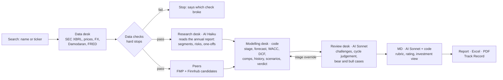

# Stock Valuation Tool

An equity research and valuation tool for US-listed companies, built as a portfolio project. Type a company name
or ticker; a team of "desks" fetches the filings, checks the data, builds a forecast and a full valuation (DCF,
comps, historical multiples, scenarios, reverse DCF, sum of the parts), challenges its own assumptions and writes an
investment view with a rating. Every number in the report can be traced back to its filing, XBRL tag and fetch time,
or to the formula and inputs that produced it. The model downloads as an Excel file with live formulas.

> Private project. Based on assumptions and public data; may contain errors; **not financial advice**.

## How it works: the desks

Plain code does the data and the maths. AI only reads, judges and writes, and every number it writes is checked
against the computed results.



| Desk | Type | Job |
|---|---|---|
| Data desk | Code | Fetch filings and market data, normalise units and FX, run data checks |
| Research desk | AI (Haiku) | Read Item 1 / 1A / 7 and the segment note; every quote and number is verified against the filing |
| Modelling desk | Code | Classify the company, build the forecast, run every valuation method, apply the verdict rules |
| Review desk | AI (Sonnet) | Challenge assumptions, explain flags, judge the cycle, write the strongest bear and bull cases |
| MD | AI (Sonnet) + code | Score the qualitative half of the rubric; code scores the rest, maps it to a rating and allows one notch |
| News desk, impact analyst | Release 2 | Not built yet |

### Code layout

| Package | What |
|---|---|
| `core/` | Settings (`.env` / Streamlit secrets), response cache with per-source TTLs, HTTP with rate limits and key redaction, store on SQLite (local) or Postgres (deployed) |
| `datasources/` | SEC EDGAR, FMP, FRED, Damodaran, Tiingo and Finnhub clients; FMP-first market data with free fallbacks |
| `data_desk/` | XBRL extraction (US GAAP + IFRS tag map, restatements, 52/53-week years, LTM), derived lines, FX, data checks, peers, filings text |
| `engine/` | **Pure** valuation engine: classification, forecast, WACC, DCF, scenarios, comps, history multiples, verdict, rubric, bridge |
| `desks/` | AI client (structured outputs, cost caps, response cache), number guard, research / review / MD desks, modelling desk, pipeline |
| `exports/` | Excel model with live formulas, PDF report, formula verifier |
| `pages/`, `ui/` | Streamlit app: password gate, search, run screen and report, Track Record, debug page |

## Setup

Requires Python 3.13 on Windows, macOS or Linux.

```bash
python -m venv .venv
.venv\Scripts\activate            # macOS/Linux: source .venv/bin/activate
pip install -r requirements.txt
copy .env.example .env            # macOS/Linux: cp .env.example .env
```

Fill in `.env`:

| Key | Where | Notes |
|---|---|---|
| `SEC_USER_NAME`, `SEC_USER_EMAIL` | your name and email | SEC requires them in the User-Agent; no sign-up |
| `FMP_API_KEY` | financialmodelingprep.com | Free plan works with gaps (see limitations); a paid plan removes them |
| `FRED_API_KEY` | fred.stlouisfed.org | Free |
| `TIINGO_API_KEY`, `FINNHUB_API_KEY` | tiingo.com, finnhub.io | Free fallbacks when FMP refuses a symbol |
| `ANTHROPIC_API_KEY` | console.anthropic.com | AI desks |
| `MAX_COST_PER_REPORT`, `MAX_COST_PER_DAY` | defaults 0.50 / 2.00 US$ | AI spend caps, checked before every call |

Run the app:

```bash
streamlit run app.py
```

## Deploying (private website)

The app runs on Streamlit Community Cloud behind a password. Saved reports, the Track Record, estimate snapshots,
the AI spend ledger and the AI response cache live in a hosted Postgres database (Neon free tier), because Streamlit
Cloud wipes local files on restart. Locally, without `DATABASE_URL`, everything stays in `data/vt.sqlite`.

1. Create a free Postgres database at neon.tech and copy its connection string.
2. In `.env`, set `APP_PASSWORD` (12+ characters) and `DATABASE_URL`.
3. Run `python scripts/deploy_prep.py`: checks the keys, tests the database, copies your local reports and track
   record into it, and writes `.streamlit/secrets.toml` (gitignored).
4. At share.streamlit.io: **Create app** from this repo, branch `main`, file `app.py`; under **Advanced settings**
   choose Python 3.13 and paste the contents of `.streamlit/secrets.toml` into **Secrets**.

Without `APP_PASSWORD` the deployed app stays locked. The theme is in `.streamlit/config.toml`.

## Tests

```bash
pytest              # offline: 185 tests, recorded fixtures, no network
pytest -m live      # live API smoke tests (uses your keys and quotas)
```

Golden tests (PROMPT.md section 15):

| # | Test | Status |
|---|---|---|
| 1a | `test_grab_data`: Grab historicals vs the hand-built model | Pass: revenue and shares match; D&A, capex, debt and cash differ by definition and are recorded as known differences |
| 1b | `test_grab_engine`: engine with the model's own assumptions | Pass: reproduces US$5.3929 exactly, plus every FCF and the 25-cell data table |
| 1c | `test_grab_judgement`: bridge from the model to the tool's defaults | Pass: US$5.39 to US$1.46; the operating-margin step (adjusted EBITDA vs GAAP margin with SBC) is the largest driver |
| 2 | Uber historicals FY2023-FY2025 and the net-income flag | Pass |
| 3 | ASML: EUR reporting, period-average vs period-end FX | Pass |
| 4 | AAPL: September year end, LTM | Pass |
| 5 | KO classified as mature stable | Pass |
| 6 | Cyclical (MU): classified cyclical, mid-cycle normalisation | Pass |
| 7-9 | JPM, O, TRV financial-sector toolkits | Release 3 |
| 10 | Determinism: same cached data gives identical numbers, verdict and rating | Pass (offline test and live check) |
| 11 | Number guard: invented numbers caught, regenerated once, then dropped | Pass |

Excel exports were recalculated in full: UBER (9,611 formulas), KO (5,249) and GRAB (9,584) have no formula errors,
and the workbook's fair value equals the app's. The GRAB workbook was also opened and recalculated in Microsoft
Excel (`python scripts/excel_check.py file.xlsx`, Windows only, needs `requirements-dev.txt`).

## Screenshots for a portfolio

1. `streamlit run app.py`, search "Grab", press **Analyse** and capture the progress panel while the desks run.
2. Capture the verdict card at the top of the report and the football field (section 15).
3. Hover over any number in the historicals table to show its trace (filing, tag, fetch time).
4. Download the Excel model and capture the DCF and Sensitivity tabs (blue inputs, green links).
5. Capture the Track Record page after a few reports.

## Known limitations

- **US-listed companies only** (SEC filers). Banks, insurers and REITs get their own toolkits in Release 3; until then they run through the corporate model and show "missing key line" flags.
- **Assumption-based.** The DCF is driven by stated rules (consensus for years 1-2, fades to industry levels, statutory tax in the terminal value). With a 5.2% ten-year Treasury yield, large caps trading at 2-3% free-cash-flow yields come out well below their prices on the DCF alone; the reverse DCF shows what the price implies.
- **Free data plans.** On the free FMP plan, analyst estimates, price targets and statements are blocked for many symbols (e.g. GRAB, ASML, MU), so forecasts fall back to history and the report says so. FMP allows about 250 calls a day and Tiingo about 50 an hour; heavy use hits these limits and the app degrades to the remaining sources.
- **Temperature.** The current Claude models reject sampling settings, so "temperature 0" is replaced by caching every AI response by its exact request: re-running a stock on the same data gives the same text.
- **Filing extraction** relies on standard Item headings; integrated annual reports (e.g. ASML) extract only partly.
- **Estimate revisions** come from the tool's own daily consensus snapshots, so they appear only after 30/60/90 days of use.
- **Not financial advice.**
